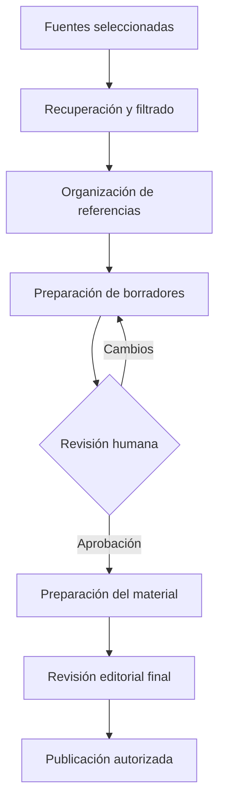

  

  
  
  
  

# Automatización de contenidos especializados para el sector salud

**Automatización de procesos · Integración de herramientas · Desarrollo de pilotos tecnológicos**

Este proyecto reúne el trabajo realizado en un **piloto de automatización editorial** orientado a investigar, organizar y preparar contenidos informativos para comunicación digital en el sector salud.

La idea fue explorar cómo aprovechar herramientas de automatización y procesamiento para **reducir tareas repetitivas**, facilitar la organización de fuentes y preparar materiales para revisión, sin sustituir el criterio de las personas responsables de aprobar el contenido.

El caso se presenta de forma anónima y se concentra en las tecnologías, pruebas y decisiones de diseño que puedo compartir.

## El desafío

Preparar contenido informativo especializado requiere consultar fuentes, seleccionar temas pertinentes, revisar afirmaciones, organizar referencias y coordinar la producción de materiales.

Cuando estas actividades se realizan en diferentes herramientas sin un flujo común, el trabajo puede volverse difícil de seguir.

El objetivo del piloto fue **conectar algunas de esas actividades mediante automatización**, conservando puntos de revisión humana antes de preparar o publicar información sanitaria.

## Herramientas y componentes

Durante el piloto se trabajó con una combinación de orquestación, servicios locales y herramientas colaborativas.

| Componente | Uso en el piloto |
| --- | --- |
| **n8n Community y Docker** | Configuración del entorno de automatización y orquestación de flujos. |
| **Python y FastAPI** | Servicio local utilizado durante las pruebas de procesamiento e integración. |
| **JavaScript** | Transformación y filtrado de información dentro de los flujos. |
| **Pillow** | Pruebas de procesamiento y composición de imágenes. |
| **Fuentes RSS** | Recuperación y filtrado de información. |
| **Google Sheets y Drive** | Organización de materiales y apoyo al proceso de revisión. |

## Cómo planteamos el flujo editorial

La propuesta organizaba el trabajo desde la consulta de fuentes hasta la preparación del contenido para los canales autorizados.

Este diagrama muestra el **flujo de trabajo que buscamos construir**. Las pruebas realizadas se concentraron en componentes e integraciones específicas, no en una operación automatizada completa de extremo a extremo.

[Conocer la arquitectura del piloto](docs/architecture.md).

## Trabajo técnico realizado

Entre las actividades desarrolladas y probadas se encuentran:

- Configuración de un entorno local de automatización con **n8n Community y Docker**.
- Integración de flujos con un servicio local implementado mediante **FastAPI**.
- Recuperación y filtrado de información procedente de fuentes **RSS**.
- Procesamiento gráfico mediante **Python y Pillow**.
- Organización de materiales y revisión con herramientas colaborativas.

Estas pruebas permitieron explorar la interacción entre herramientas con responsabilidades diferentes: recuperación de información, transformación de datos, procesamiento y revisión editorial.

## Decisiones de diseño

El piloto reforzó varias decisiones importantes para cualquier automatización de contenidos especializados:

1. **Separar orquestación y procesamiento:** los flujos coordinan tareas, mientras los servicios especializados realizan transformaciones concretas.
2. **Conservar la procedencia de la información:** las referencias ayudan a revisar y contextualizar los borradores.
3. **Incluir revisión humana:** las afirmaciones sanitarias no deben difundirse automáticamente sin validación competente.
4. **Probar integraciones por separado:** antes de ampliar un flujo conviene comprobar entradas, salidas y errores de cada componente.
5. **Proteger la información:** los flujos y materiales del cliente deben permanecer fuera del repositorio público.

## Mi experiencia con este caso

Este piloto forma parte de mi trabajo en **automatización de procesos, integración de servicios y exploración de herramientas de inteligencia artificial aplicada**.

El principal aprendizaje fue abordar la automatización como un proceso de ingeniería: identificar tareas repetitivas, definir responsabilidades entre componentes, probar conexiones y mantener supervisión sobre los resultados.

La experiencia no se presenta como un sistema clínico ni como una plataforma de publicación autónoma.

## Evolución posible

Me interesa explorar cómo evolucionar este enfoque hacia flujos más completos de investigación, preparación y revisión de contenidos.

Entre las posibilidades futuras están el uso de **modelos de lenguaje, recuperación aumentada (RAG) y agentes**, sujetos a pruebas y criterios claros de calidad. Estos componentes no forman parte de las integraciones productivas documentadas en este piloto.

[Consultar pruebas y aprendizajes](docs/validation-and-lessons.md).

## Sobre el proyecto

Este repositorio comparte una descripción del piloto sin identificar al cliente ni publicar sus flujos originales, credenciales, documentos internos o información clínica.

---

<strong>Automatizar tareas repetitivas sin perder la responsabilidad editorial.</strong>

<a href="https://github.com/isaiassolis">Isaías Solís · Portafolio profesional</a>

