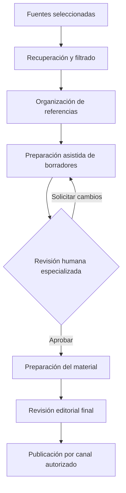

  

  
  
  
  

# Automatización de contenidos especializados para el sector salud

**Caso de estudio anonimizado** de un proyecto piloto de investigación, organización y preparación de contenido informativo para comunicación digital en el sector salud.

> **Aviso de alcance:** este repositorio describe actividades y pruebas técnicas; no contiene el código ni los flujos internos del cliente. No es un producto clínico, un sistema de apoyo al diagnóstico ni una demostración de operación integral en producción.

## 🎯 El reto

La producción de contenido de salud requiere identificar temas relevantes, consultar fuentes confiables, organizar referencias y someter los borradores a revisión antes de publicar. Un proceso enteramente manual puede fragmentar la información entre diversas herramientas y dificultar el seguimiento editorial.

**Objetivo del piloto:** explorar cómo automatizar pasos repetitivos del flujo editorial, manteniendo la evaluación humana de las afirmaciones relacionadas con salud.

## 🧩 Enfoque de solución

Se trabajó con una combinación de orquestación, procesamiento y almacenamiento:

| Componente | Función en el trabajo documentado |
| :-- | :-- |
| **n8n Community + Docker** | Entorno de orquestación de flujos |
| **Python / FastAPI** | Servicio local de procesamiento e integración en pruebas |
| **JavaScript** | Transformación o filtrado de datos en los flujos |
| **Pillow** | Procesamiento/composición de imágenes en pruebas técnicas |
| **Google Sheets / Drive** | Herramientas utilizadas para organizar y revisar materiales |
| **Fuentes RSS** | Insumo empleado en pruebas de recuperación y filtrado de información |

**IA generativa, agentes y RAG:** son líneas de interés y exploración relacionadas con la evolución del proceso. Este caso **no afirma** que hubiera agentes autónomos o RAG en producción ni atribuye resultados a componentes no verificados.

## 🔄 Flujo editorial conceptual

**Importante:** el diagrama representa el **flujo objetivo**, no una certificación de que todas las etapas se automatizaron o publicaron sin intervención manual.

Para ver los componentes y límites de la implementación, consulta [arquitectura y flujo](docs/architecture.md).

## 🧪 ¿Qué se ha documentado?

**Actividades técnicas reportadas:**
- Configuración de un entorno de automatización con n8n Community y Docker.
- Pruebas de integración entre el flujo automatizado y un servicio local con FastAPI.
- Pruebas de recuperación y filtrado de contenido de fuentes RSS.
- Pruebas de procesamiento gráfico con Python/Pillow.
- Organización y revisión humana de contenido mediante herramientas colaborativas.

**No demostramos en este repositorio:**
- Producción autónoma de contenidos médicos sin revisión humana.
- Despliegue completo y sostenido en producción.
- Agentes inteligentes o arquitectura RAG operativa.
- Métricas comprobadas de ahorro, precisión, costos o retorno de inversión.

Consulta [validaciones y limitaciones](docs/validation-and-lessons.md).

## 👨‍💻 Competencias ilustradas

Este caso se presenta para explicar un proceso de **análisis de necesidades, diseño de flujo, integración de herramientas, pruebas técnicas y supervisión de resultados**. La documentación no pretende atribuir a una sola persona decisiones o entregables cuyo alcance de responsabilidad no ha sido validado.

## 🔒 Privacidad y uso responsable

- No se identifica al cliente ni se comparten documentos internos.
- No se publican credenciales, endpoints privados, datos personales o clínicos.
- No se reutilizan flujos originales sin revisión de su contenido y autorización.
- Toda información sanitaria generada o sintetizada requiere revisión por una persona competente antes de difusión.

## 📚 Documentación

- [Arquitectura y flujo conceptual](docs/architecture.md)
- [Validaciones, límites y aprendizajes](docs/validation-and-lessons.md)

---

<strong>Automatizar lo repetitivo sin automatizar la responsabilidad editorial.</strong>

Caso documentado por <a href="https://github.com/isaiassolis">Isaías Solís</a>

