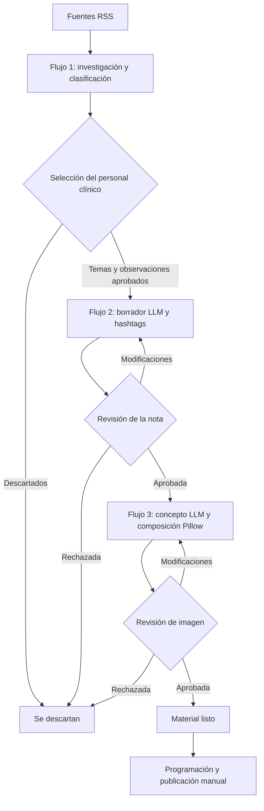

  

  
  
  
  

# Automatización de contenidos especializados para el sector salud

**Diseño de solución · n8n · Inteligencia artificial aplicada · Flujos editoriales con supervisión clínica**

Diseñé e integré un **sistema de automatización editorial para el sector salud**, organizado en **tres flujos de trabajo con n8n**. La solución conecta investigación de contenidos, elaboración asistida de notas e ilustraciones, y tres momentos de decisión y aprobación por parte del **personal clínico**.

**El proyecto continúa en funcionamiento** y se encuentra en evolución, con planes de ampliación hacia **nuevos clientes y áreas**.

El objetivo es ayudar a los equipos a preparar contenido informativo relevante y visualmente consistente, **sin delegar en la IA las decisiones médicas, editoriales ni la publicación final**.

## El desafío

La comunicación especializada en salud requiere investigar temas pertinentes, contrastar información, elaborar borradores comprensibles y mantener criterios editoriales y visuales consistentes. Todo ello demanda tiempo del personal que también debe evaluar la relevancia y exactitud de lo que se publica.

Diseñé una solución para automatizar las tareas de búsqueda, organización y preparación, manteniendo **aprobaciones humanas entre cada etapa**.

## Tres flujos que trabajan de forma coordinada

### 1. Investigación, selección y priorización de temas

El primer flujo consulta **fuentes RSS**, recupera información relacionada con el área de interés, identifica los contenidos más relevantes y los **clasifica y organiza**.

Los temas encontrados se presentan al **personal clínico**, que determina cuáles son útiles, cuáles deben descartarse y qué observaciones deben considerarse antes de redactar.

**Resultado:** temas seleccionados y observaciones aprobadas por el equipo clínico.

### 2. Redacción asistida por LLM y revisión médica

El segundo flujo toma los temas aprobados y las observaciones del equipo para generar **borradores de notas informativas mediante un modelo de lenguaje**, incluyendo propuestas de **hashtags**.

Los borradores regresan al personal médico, que puede:

- Aprobar la nota.
- Solicitar modificaciones o añadir observaciones.
- Rechazar el contenido.

Cuando se solicitan cambios, el flujo asistido por IA prepara una **nueva versión** e informa al equipo para su siguiente revisión. El proceso se repite hasta obtener la aprobación correspondiente.

**Resultado:** notas y hashtags revisados y aprobados por el equipo médico.

### 3. Concepto ilustrado y composición visual

El tercer flujo recibe únicamente las **notas aceptadas** y genera una propuesta de **concepto visual asistido por LLM**.

Integré **Python y Pillow** para construir materiales gráficos con un formato y una composición homogéneos. Esta combinación permite mantener reglas visuales explícitas y limitar la variabilidad de los resultados generativos, aunque las imágenes y afirmaciones siguen requiriendo revisión.

La propuesta se presenta nuevamente al **cuerpo médico**, que puede aprobarla, rechazarla o solicitar modificaciones.

**Resultado:** contenido escrito e ilustración aprobados.

### Publicación final: decisión manual

**La programación y publicación de las notas son manuales, por petición expresa del personal médico.** La automatización finaliza con los materiales aprobados y listos para su uso por los responsables del canal.

## Arquitectura funcional

## Tecnologías y herramientas

| Componente | Papel en el sistema |
| --- | --- |
| **n8n Community / Docker** | Orquestación de los tres flujos y sus decisiones. |
| **RSS** | Investigación, recuperación y selección inicial de fuentes. |
| **LLM** | Apoyo a redacción, revisión de borradores, hashtags y conceptos visuales. |
| **Python / FastAPI** | Procesamiento e integración de servicios. |
| **JavaScript** | Filtrado, clasificación y transformación de datos dentro de los flujos. |
| **Pillow** | Composición de gráficos con criterios visuales uniformes. |
| **Google Sheets / Drive** | Organización de materiales y colaboración. |
| **Personal clínico** | Selección temática, revisión, correcciones y aprobación. |

[Conocer la arquitectura y el flujo de aprobaciones](docs/architecture.md).

## Mi participación

**Diseñé los tres flujos de n8n** y la estructura de interacción entre automatización, modelos de lenguaje y revisión clínica.

Trabajé en la investigación y clasificación de información desde RSS, la integración del proceso de aprobación de temas, la generación iterativa de notas y hashtags, y la preparación de conceptos gráficos mediante LLM y Pillow.

Un principio central del diseño fue que **ningún contenido avance a la siguiente fase sin la decisión del equipo médico**.

## Estado y evolución

La solución **está en funcionamiento**, con un proceso editorial supervisado de principio a fin. La siguiente etapa contempla **adaptarla para nuevos clientes y otras áreas de contenido**, conservando la separación de flujos y los controles de aprobación.

La ampliación requerirá configurar fuentes, criterios de relevancia, instrucciones editoriales, formatos visuales y responsables de revisión para cada contexto.

[Consultar aprendizajes y oportunidades de mejora](docs/validation-and-lessons.md).

## Sobre el proyecto

Este repositorio presenta la solución sin identificar al cliente actual ni divulgar sus documentos, flujos privados, credenciales o información sanitaria confidencial. **No es una aplicación de diagnóstico clínico**.

---

<strong>Investigación, redacción e ilustración asistidas por IA; decisión y publicación bajo control humano.</strong>

<a href="https://github.com/isaiassolis">Isaías Solís · Portafolio profesional</a>

