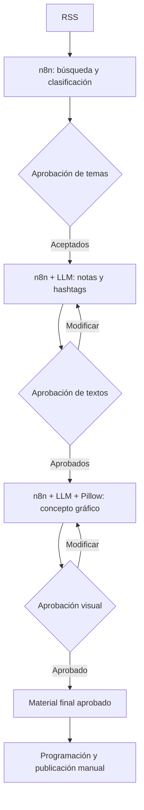

# Arquitectura — Automatización editorial para el sector salud

## Diseño de la solución

Diseñé una solución **operativa y en evolución**, organizada en **tres flujos n8n**. Cada flujo recibe entradas aprobadas por el personal clínico y produce información para la siguiente decisión humana.

La programación y publicación final se realizan manualmente por decisión del equipo médico.

## Flujo 1 — Investigación y clasificación

**Entrada:** fuentes RSS y temas de interés del área clínica.

**Procesamiento:** consulta, recuperación, filtrado, clasificación y organización de temas según su relevancia.

**Control humano:** el personal clínico revisa la selección, acepta o descarta temas e incorpora observaciones.

**Salida:** temas y observaciones aprobados para la redacción.

## Flujo 2 — Redacción y revisión

**Entrada:** temas aceptados y comentarios clínicos.

**Procesamiento:** un **LLM** prepara borradores de notas y hashtags. Si recibe observaciones de revisión, genera una versión modificada e informa al equipo.

**Control humano:** aprobación, rechazo o solicitud de cambios.

**Salida:** notas aprobadas y sus hashtags.

## Flujo 3 — Ilustración y composición

**Entrada:** notas aprobadas.

**Procesamiento:** el **LLM** propone el concepto visual; **Python y Pillow** ayudan a generar una composición homogénea y a aplicar reglas de presentación.

**Control humano:** revisión del personal médico, con aceptación, rechazo o solicitud de ajustes.

**Salida:** piezas escritas e ilustradas aprobadas.

## Cierre manual

La **programación y publicación** quedan bajo responsabilidad humana. No son el cuarto flujo ni una acción de publicación automática.

## Vista de arquitectura

## Componentes tecnológicos

| Tecnología | Función |
| --- | --- |
| **n8n Community y Docker** | Orquestación, conexiones y transiciones de los tres flujos. |
| **RSS** | Recuperación de información y fuentes. |
| **LLM** | Redacción, modificación de notas, hashtags y propuesta visual. |
| **Python y FastAPI** | Integración de servicios y procesamiento. |
| **JavaScript** | Filtrado y transformación de datos. |
| **Pillow** | Composición y uniformidad de materiales gráficos. |
| **Google Sheets y Drive** | Organización y revisión de información. |

## Decisiones de ingeniería

- **Separación por responsabilidades:** investigar, redactar e ilustrar son procesos diferentes.
- **Aprobación entre etapas:** los materiales avanzan solo cuando el personal clínico los acepta.
- **Iteración controlada:** las correcciones vuelven al flujo correspondiente y se someten a nueva revisión.
- **Consistencia visual:** utilizar Pillow y reglas de composición para reducir variaciones entre piezas.
- **Publicación manual:** mantener la decisión editorial final fuera de la automatización.
- **Expansión configurable:** adaptar fuentes, criterios y formatos a nuevos clientes y áreas.

[← Volver al proyecto](../README.md)
