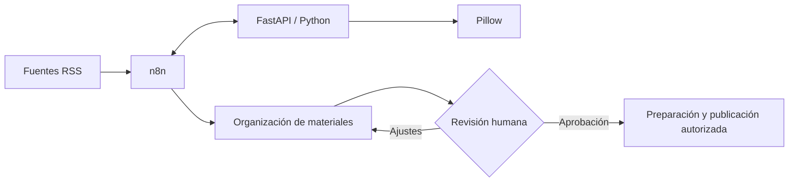

# Healthcare Content Automation — Arquitectura del piloto

## Objetivo

El piloto exploró cómo conectar herramientas de automatización, procesamiento de información y revisión editorial para apoyar la producción de contenidos informativos especializados en el sector salud.

El trabajo comprendió **pruebas de integración entre componentes** y la definición de un flujo editorial que mantiene la revisión humana antes de la publicación.

## Componentes tecnológicos

| Capa | Herramienta | Función |
| --- | --- | --- |
| Orquestación | **n8n Community y Docker** | Coordinar tareas y conexiones. |
| Procesamiento | **Python y FastAPI** | Servicio local probado durante la integración. |
| Transformaciones | **JavaScript** | Normalización y filtrado de datos. |
| Imágenes | **Pillow** | Procesamiento gráfico en pruebas. |
| Fuentes | **RSS** | Recuperación y filtrado de información. |
| Colaboración | **Google Sheets y Drive** | Organización y revisión de materiales. |
| Validación editorial | **Revisión humana** | Evaluar pertinencia, precisión y aprobación. |

## Flujo de integración

El esquema combina **integraciones ensayadas** con pasos del **proceso editorial previsto**. Su objetivo es explicar la organización de la solución, no describir una ejecución completa ya desplegada.

## Criterios de diseño

- **Responsabilidades claras:** la orquestación, el procesamiento y la revisión editorial cumplen funciones distintas.
- **Trazabilidad:** conservar las referencias utilizadas para preparar materiales cuando el flujo lo permita.
- **Control humano:** revisar las afirmaciones relacionadas con salud antes de divulgarlas.
- **Integración progresiva:** comprobar cada conexión antes de incorporar nuevas etapas.
- **Privacidad y seguridad:** mantener credenciales, datos de clientes y configuraciones sensibles fuera de los materiales públicos.

## Evolución tecnológica

La arquitectura podría incorporar más adelante **modelos de lenguaje, RAG o agentes** para asistir tareas de consulta y preparación, siempre que existan requisitos, pruebas y mecanismos de supervisión suficientes.

El piloto documentado utiliza las herramientas descritas anteriormente; no incorpora una arquitectura productiva de agentes autónomos.

[← Volver al proyecto](../README.md)
