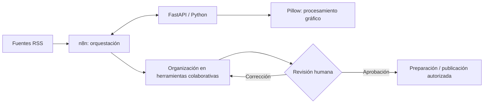

# Arquitectura y flujo conceptual

## Propósito y alcance

Se representa el enfoque de un **piloto de automatización editorial** para contenidos especializados del sector salud. Este documento separa herramientas reportadas, integración ensayada y etapas objetivo.

## Componentes

| Capa | Herramienta | Papel |
|---|---|---|
| Orquestación | n8n Community en Docker | Coordinar tareas y conexiones |
| Procesamiento | Python, FastAPI | Servicio local integrado durante pruebas |
| Transformaciones | JavaScript | Normalización y filtrado dentro de flujos |
| Imágenes | Pillow | Procesamiento gráfico en pruebas |
| Información | Fuentes RSS | Recuperación y filtrado ensayados |
| Colaboración | Google Sheets / Drive | Organización y revisión de materiales |
| Revisión | Personas responsables | Verificar rigor, pertinencia y aprobación |

## Diagrama de integración ilustrativo

El diagrama **no acredita** una ejecución extremo a extremo del flujo, ni señala que todas las conexiones estén activas actualmente. Distinguir servicios probados de funcionalidad final es fundamental.

## Consideraciones de diseño

1. **Separación de responsabilidades.** La orquestación de procesos no sustituye las funciones de procesamiento especializado ni la supervisión.
2. **Trazabilidad.** Asociar las afirmaciones y borradores con las fuentes consultadas, cuando los datos lo permitan.
3. **Control humano.** No difundir automáticamente afirmaciones sanitarias generadas por IA.
4. **Operación segura.** No almacenar tokens o datos personales en ejemplos públicos; gestionar credenciales fuera del código.
5. **Evolución posible.** Modelos de lenguaje, RAG o agentes podrían evaluarse posteriormente, mediante requisitos, pruebas y control de calidad.

## Fuera del alcance de este repositorio

No se incluyen archivos fuente del cliente, workflows reales exportados, API keys, datos clínicos, capturas internas, integraciones con sistemas de expedientes, ni cifras de resultados no medidas.
